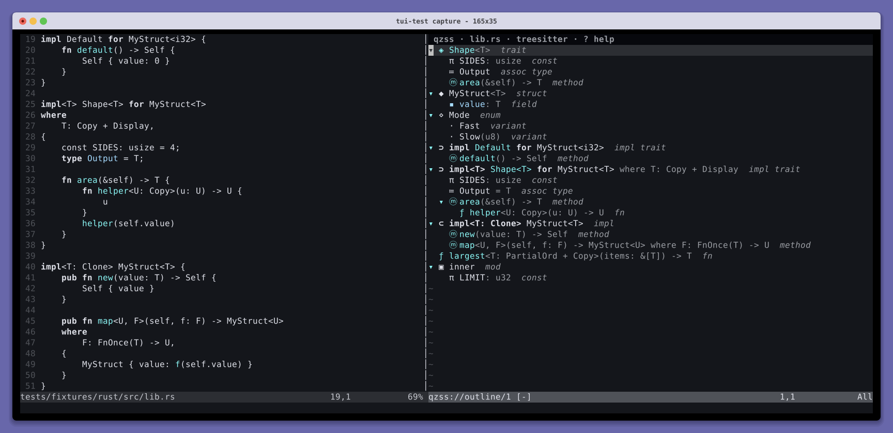
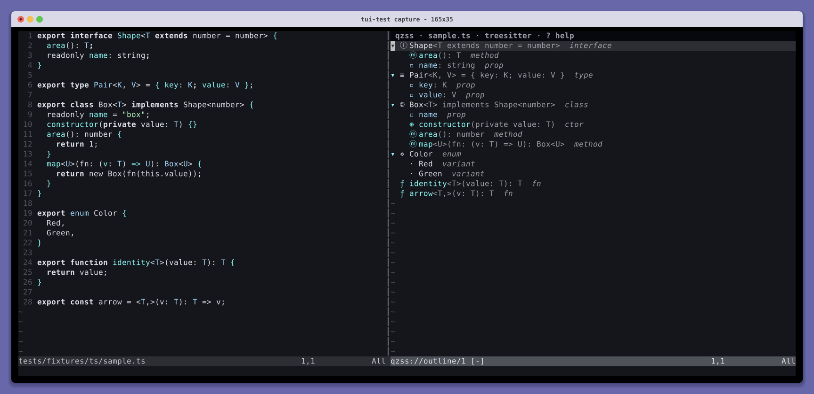
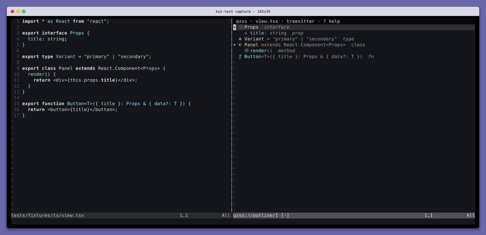
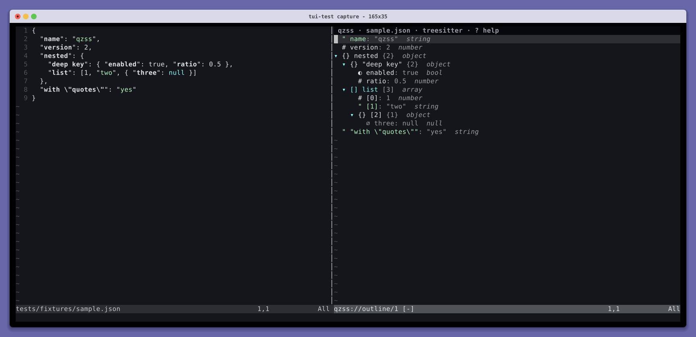
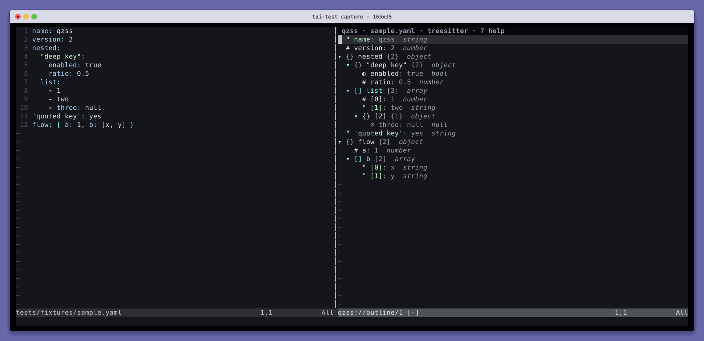
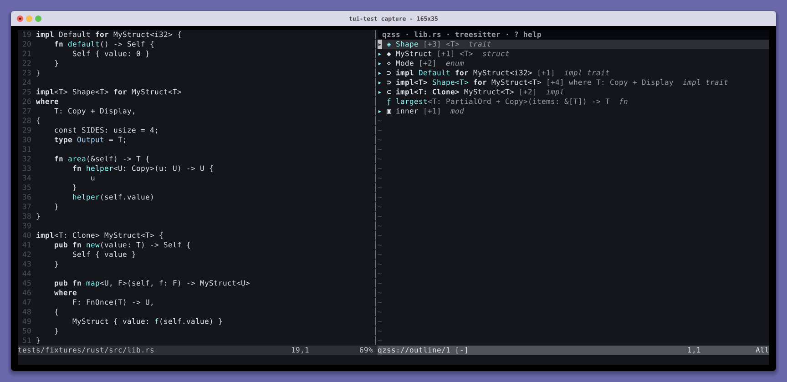
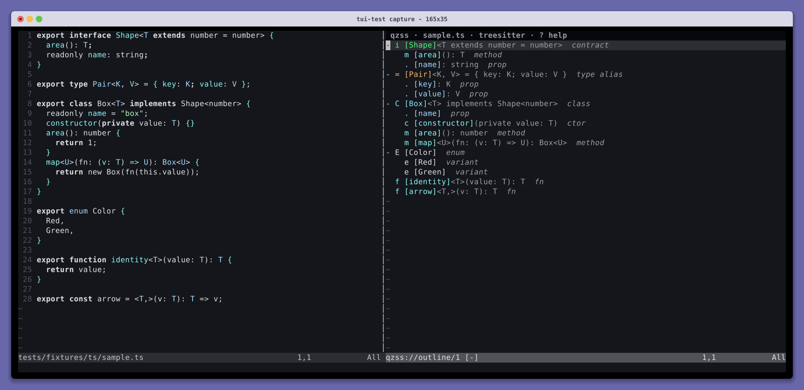
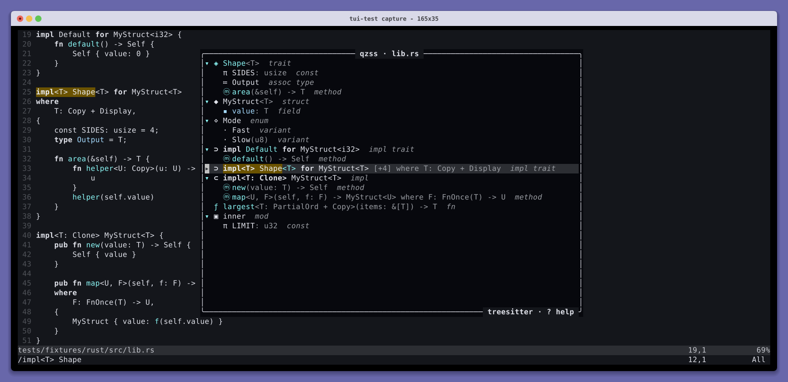
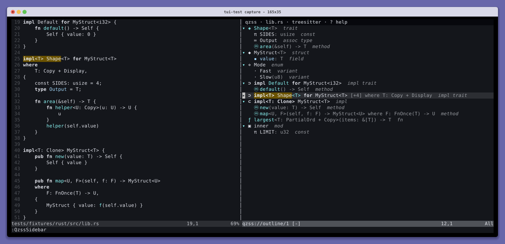

# qzss.nvim

A small, semantic outline for Neovim, shown as a sidebar or a floating window, focused on **Rust**, **TypeScript/TSX**, **JSON** and **YAML**. A [Lua API](docs/api.md) gives other plugins the same symbols without opening any UI.

It was written because general-purpose outline plugins made a few things hard to read:

- Rust `impl` blocks: which is the trait and which is the self type, and what are the generics and `where` bounds?
- TypeScript `class`, `interface` and `type` alias all looked like the same kind of thing.
- JSON/YAML: only object-valued keys were shown; array indexes and scalar values were missing.
- Folded nodes lost their kind/icon, so you could not tell what was collapsed.



## Features

- **Rust impls shown in source order.** You see `impl Default for MyStruct<i32>`, `impl<T> Shape<T> for MyStruct<T> where T: Copy + Display` and inherent `impl<T: Clone> MyStruct<T>`. A trait impl (`⊃`, `impl trait`) and an inherent impl (`⊂`, `impl`) are separate kinds. Trait and self type have their own highlights. Associated consts and types, methods, and functions nested inside methods all appear as children.
- **Generics kept intact.** Type parameters, bounds, parameters, return types and `where` clauses come from the Tree-sitter syntax tree. When a language server is attached, its `DocumentSymbol.detail` fills in symbols that have no syntax signature. Details that duplicate the signature are shown once (`detail_source` option).
- **Distinct TypeScript kinds.** `Class` (`©`), `Interface` (`ⓘ`) and `TypeAlias` (`≡`) each get their own icon, label, highlight group and filter name (`:QzssFilter Interface`). The same applies to TSX.
- **JSON/YAML trees without LSP.** Keys, `[n]` array indexes, objects `{n}`, arrays `[n]` and typed scalars (string/number/bool/null) are shown with value previews. Quoted and nested keys, flow collections, anchors and multi-document YAML also work. Whitespace that is part of a value is preserved, in quoted keys, string literals and YAML plain scalars alike: `"a  b"` and `"a b"` stay different.
- **Folding keeps context.** A folded row still shows its marker, icon, name, signature and kind, plus `[+N]` hidden descendants. Fold state and the cursor row survive edits and refreshes.
- **Exact jumps.** `<CR>` jumps to the symbol's name: correct line, and the correct byte column even after multibyte text. LSP UTF-16/UTF-32 offsets are converted with the client's encoding.
- **Customisable.** Icons (presets or a table or a callback), names, details, kind labels, highlights and filters are all configurable. No Nerd Font is needed.
- **Sidebar or float.** `layout.mode = "float"` or `:QzssFloat` shows the same outline in a centered floating window. Switch with `:QzssSidebar` / `:QzssFloat` while it is open. The cursor row, folds and filter are kept.
- **Lua API for your own UI.** Get symbols (with Tree-sitter + LSP merged), the symbol under the cursor, jumps, folds, filters and update events from `require("qzss")`. Use them for pickers, statuslines or keymaps. See [docs/api.md](docs/api.md).

| TypeScript | TSX |
| --- | --- |
|  |  |

| JSON | YAML |
| --- | --- |
|  |  |

| Folded (`zM`) | Customised (ASCII icons, custom labels, name callback, colors) |
| --- | --- |
|  |  |

| Float (`:QzssFloat`, `layout.mode = "float"`) | Switched to the sidebar (`:QzssSidebar`): fold and filter kept |
| --- | --- |
|  |  |

All images are real terminal captures of Neovim running this plugin on the files in `tests/fixtures/`. See [Screenshots](#screenshots) for how to regenerate them.

## Requirements

| | |
| --- | --- |
| Neovim | **0.11 or newer** (tested on 0.11.5 and 0.12.6) |
| Tree-sitter parsers | `rust`, `typescript`, `tsx`, `json`, `yaml` for the languages you use, e.g. from [nvim-treesitter](https://github.com/nvim-treesitter/nvim-treesitter) or your distribution |
| Language servers (optional) | Any server with `textDocument/documentSymbol`, e.g. rust-analyzer or typescript-language-server, set up via `vim.lsp.config`/`vim.lsp.enable` or nvim-lspconfig |
| Fonts | No Nerd Font required (Unicode icons by default; `icons = "ascii"` is pure ASCII; `icons = "nerd"` if you have one) |

There are no runtime Lua dependencies.

Fallbacks: with a parser but no LSP, you get the Tree-sitter outline. With an LSP but no parser, or for other filetypes, you get the LSP outline. With neither, the sidebar shows why, and `:QzssInfo` gives details.

## Installation

[lazy.nvim](https://github.com/folke/lazy.nvim):

```lua
{
  "takeshiD/qzss.nvim",
  cmd = { "Qzss", "QzssOpen", "QzssFloat", "QzssSidebar" },
  keys = { { "<leader>o", "<cmd>Qzss<cr>", desc = "Outline (qzss)" } },
  opts = {},
}
```

Built-in packages (`:h packages`):

```sh
git clone https://github.com/takeshiD/qzss.nvim ~/.local/share/nvim/site/pack/plugins/start/qzss.nvim
```

Calling `setup()` is optional. The commands work with the defaults.

## Usage

| Command | Action |
| --- | --- |
| `:Qzss` | Toggle the outline for the current buffer (in `layout.mode`, sidebar by default) |
| `:QzssOpen[!]` | Open and focus the outline (`!` keeps focus in the source) |
| `:QzssFloat[!]` | Open as a float, or switch an open sidebar to a float |
| `:QzssSidebar[!]` | Open as a sidebar, or switch an open float to the sidebar |
| `:QzssClose` | Close the outline |
| `:QzssRefresh` | Recompute the outline (edits refresh automatically) |
| `:QzssFilter [Kind ...]` | Show only these kinds, e.g. `:QzssFilter Class Interface`. No arguments clears the filter. Tab-completes kind names. |
| `:QzssInfo` | Show the active source (`treesitter`, `lsp`, `treesitter+lsp`), LSP clients and errors |

Keys in the outline, sidebar or float (press `?` to see them):

| Key | Action |
| --- | --- |
| `<CR>` | Jump to the symbol (the float then closes; `layout.float.close_on_jump`) |
| `p` | Preview: move the source cursor, keep focus in the outline |
| `o` `za` `<Tab>` | Toggle fold |
| `zo` `l` / `zc` `h` | Open / close fold (`h` on a leaf closes its parent) |
| `zR` / `zM` | Open all / close all |
| `r` | Refresh |
| `q` | Close (in the float `<Esc>` closes too) |
| `?` | Key help |

The outline follows the source cursor. Its title bar (the float's border title and footer) shows the file, the source in use, and an active filter. On a narrow terminal the sidebar shrinks so the source keeps at least half the width, or all but 30 columns. The float always fits on screen and follows terminal resizes. When you `:q` the last source window, the outline closes too, so Neovim exits (or the tab closes) as usual. Full reference: `:help qzss`.

## Configuration

Defaults:

```lua
require("qzss").setup({
  backends = { "treesitter", "lsp" },  -- order/availability of sources
  detail_source = "merge",             -- "merge" | "treesitter" | "lsp"
  layout = { mode = "sidebar", position = "right", width = 36, max_width = 64,
             float = { relative = "editor", width = 0.5, height = 0.8, position = "center",
                       border = "rounded", winblend = 0, title = true, close_on_jump = true } },
  icons = "unicode",                   -- "unicode" | "ascii" | "nerd" | { Kind = "icon" }
  kind_labels = {},                    -- { Interface = "iface" }; false hides labels
  show_kind = true,
  show_detail = true,
  highlights = {},                     -- { Class = "MyGroup", Detail = { fg = "#888888" } }
  format_name = nil,                   -- function(symbol, ctx) -> string
  format_detail = nil,                 -- function(symbol, ctx) -> string ("" hides)
  get_icon = nil,                      -- function(symbol, ctx) -> icon, hl_group?
  filter = nil,                        -- function(symbol, ctx) -> false hides it
  filter_kinds = {},                   -- per filetype, e.g. { typescript = { "Class", "Interface" } }
  collapse_level = nil,                -- collapse nodes deeper than this on first open
  follow_cursor = true,
  update_delay = 150,                  -- ms after an edit
  close_on_jump = false,               -- inherited by float unless layout.float.close_on_jump overrides it
  toggle_key = nil,                    -- e.g. "<leader>o"
  keymaps = { jump = "<CR>", preview = "p", toggle_fold = { "o", "za", "<Tab>" },
              open_fold = { "zo", "l" }, close_fold = { "zc", "h" }, open_all = "zR",
              close_all = "zM", refresh = "r", close = "q", help = "?", float_close = "<Esc>" },
  max_detail = 48,                     -- max characters of a value preview
})
```

Callbacks receive `(symbol, ctx)` where `ctx = { bufnr, filetype, depth }`. A symbol has `name`, `kind`, `detail`, `lnum`, `col` and `children`. Rust impls also have `trait`, `self_type`, `type_params` and `where_clause`.

### Examples

Pure-ASCII icons, custom labels and colours (this is the "Customised" screenshot):

```lua
require("qzss").setup({
  icons = "ascii",
  kind_labels = { Interface = "contract", TypeAlias = "type alias" },
  format_name = function(s) return "[" .. s.name .. "]" end,
  highlights = {
    Class = { fg = "#8be9fd" },
    Interface = { fg = "#50fa7b" },
    TypeAlias = { fg = "#ffb86c" },
  },
})
```

Use Nerd Font icons and override a few:

```lua
require("qzss").setup({
  icons = "nerd",
  get_icon = function(s)
    if s.kind == "TraitImpl" then return "󰡱", "Special" end
  end,
})
```

Shorter Rust impl rows (drop `where` clauses) and no value previews in data files:

```lua
require("qzss").setup({
  format_detail = function(s, ctx)
    if ctx.filetype == "json" or ctx.filetype == "yaml" then return "" end
    if s.kind == "TraitImpl" or s.kind == "Impl" then return "" end -- hides where clauses
  end,
  format_name = function(s)
    if s.kind == "TraitImpl" then return ("%s for %s"):format(s.trait, s.self_type) end
  end,
})
```

Only types in TypeScript, collapsed below the top level, sidebar on the left:

```lua
require("qzss").setup({
  layout = { position = "left", width = 40 },
  filter_kinds = { typescript = { "Class", "Interface", "TypeAlias", "Enum" } },
  collapse_level = 1,
})
```

LSP detail instead of the syntax signature:

```lua
require("qzss").setup({ detail_source = "lsp" })
```

### Float layout

The float is sized and placed relative to the editor (or to the source window with `relative = "win"`). Sizes are cells (`>= 1`) or fractions (`0 < x < 1`). They are limited to `min_*`/`max_*` and then to what fits, so the float always fits a small terminal. It follows `VimResized`. Full option list: [docs/api.md#layout-sidebar-and-float](docs/api.md#layout-sidebar-and-float) or `:help qzss-float`.

```lua
require("qzss").setup({
  layout = {
    mode = "float",
    float = { width = 0.4, height = 0.9, position = "right", border = "single", winblend = 10 },
  },
})
```

### Kinds and highlights

Kinds: `Module Struct Enum EnumMember Trait Impl TraitImpl Function Method Constructor Field Property Constant Variable TypeAlias AssociatedType Class Interface Macro Object Array String Number Boolean Null Document`.

Each kind has a highlight group `Qzss<Kind>` linked to a standard group (`QzssClass` → `Type`, `QzssInterface` → `Structure`, `QzssTypeAlias` → `Typedef`, `QzssFunction` → `Function`, …). Colours therefore follow your colorscheme. More groups:

- `QzssDetail`: signature and value preview (Comment).
- `QzssKindLabel`: Comment colour in italic, re-derived on `:colorscheme`.
- `QzssFold`, `QzssFoldCount`.
- `QzssKeyword`, `QzssTraitName`, `QzssSelfType`: the parts of a Rust impl row.

Override them in `highlights` (the `Qzss` prefix is optional) or in your colorscheme. User overrides win over the defaults, including after `:colorscheme`.

## Lua API

`require("qzss")` is a stable API (`api_version = 1`). The commands and keys use it too. With it you can open, close or switch the outline, read symbols without any UI (Tree-sitter and LSP merged, async with cancel), find the symbol under the cursor, jump, fold, filter, and subscribe to updates. The full reference has types, position/range rules, events, a compatibility policy and more examples (picker, quickfix, custom UI, keymaps): **[docs/api.md](docs/api.md)** and `:help qzss-api`. Every example below and in docs/api.md is run by `tests/docs_examples.lua`.

Float by default, sidebar on another key:

<!-- example: readme-float -->
```lua
require("qzss").setup({ layout = { mode = "float" } })
-- :Qzss now toggles the float. Keep a key for the sidebar too:
vim.keymap.set("n", "<leader>o", "<cmd>Qzss<cr>", { desc = "Outline (float)" })
vim.keymap.set("n", "<leader>O", function()
  require("qzss").open({ mode = "sidebar" })
end, { desc = "Outline (sidebar)" })
```

Statusline breadcrumb (`impl<T> Shape<T> for MyStruct<T> › area › helper`):

<!-- example: readme-statusline -->
```lua
function _G.qzss_breadcrumb()
  local _, path = require("qzss").current_symbol()
  if type(path) ~= "table" then
    return "" -- "pending", "no symbol", ...
  end
  local names = {}
  for _, s in ipairs(path) do
    table.insert(names, s.name)
  end
  return table.concat(names, " › ")
end
require("qzss").subscribe("symbols", function()
  vim.cmd.redrawstatus()
end)
vim.o.statusline = "%f %{v:lua.qzss_breadcrumb()}%=%l,%c"
```

Walk the symbol tree without opening the outline (here: all functions into the quickfix list):

<!-- example: readme-symbols -->
```lua
local qzss = require("qzss")
qzss.request_symbols(0, function(err, snap)
  if err then
    return vim.notify("qzss: " .. err, vim.log.levels.WARN)
  end
  local items = {}
  local function walk(list)
    for _, s in ipairs(list) do
      if s.kind == "Function" or s.kind == "Method" then
        table.insert(items, {
          bufnr = s.bufnr,
          lnum = s.pos[1],
          col = s.pos[2] + 1, -- quickfix columns are 1-based
          text = ("%s%s %s%s"):format(string.rep("  ", s.depth), s.kind, s.name, s.detail),
        })
      end
      walk(s.children)
    end
  end
  walk(snap.symbols)
  vim.fn.setqflist({}, " ", { title = "qzss functions", items = items })
end)
```

## Limitations

- Supported by the Tree-sitter extractor: Rust, TypeScript, TSX, JSON/JSONC, YAML. Other filetypes rely on an attached language server.
- Items generated by Rust macros are not shown (Tree-sitter does not expand macros).
- Only the first attached LSP client that supports `documentSymbol` is queried. Tree-sitter stays the authority for structure when both sources are available.
- **LSP-only mode** (`backends = { "lsp" }`, or a filetype without a parser): kinds come from the server's `SymbolKind`. typescript-language-server reports a `type` alias as Variable and enum members as Constant. If the TypeScript/TSX Tree-sitter parser is installed, qzss uses it to restore TypeAlias, Interface and EnumMember. Without the parser, those symbols appear as `var` and `const`. Signatures are whatever `DocumentSymbol.detail` provides (often empty for tsserver). Symbols are re-sorted into source order.
- One outline (sidebar or float) per tab page. It follows the current file buffer.
- The float has a fixed configured size. It does not shrink to its content like the sidebar does.
- Only the first LSP client with `documentSymbol` is asked, with an 8 s timeout. `cancel()` of a symbol request drops your callback, but the computation still finishes and fills the cache.
- This is not a drop-in replacement for aerial.nvim. There is no built-in Telescope/Snacks/lualine integration and no extra languages. The [Lua API](docs/api.md) makes such integrations a few lines each (a `vim.ui.select` picker and a statusline breadcrumb are documented and tested).

## Development

```sh
sh scripts/bootstrap.sh   # builds the 5 parsers into .deps/site, downloads rust-analyzer into .deps/bin
npm ci                    # typescript + typescript-language-server (dev only)
sh scripts/test.sh        # all suites, or: sh scripts/test.sh unit edge readme lsp tui help images api docs
KENSHU_CLI=/path/to/kenshu-loop.mjs sh scripts/test.sh scenarios   # real-PTY scenarios (needs kenshu-loop)
```

Needs `git`, a C compiler, `curl`, Node.js ≥ 20, `tmux`, and Neovim ≥ 0.11. Set `QZSS_RUST_ANALYZER=/path/to/rust-analyzer` to use an existing binary.

| Suite | File | What it checks |
| --- | --- | --- |
| unit | `tests/run.lua` | Tree-sitter extraction for all fixtures, rendering, folding, filters, customisation, sidebar, fallbacks, whitespace in literals, LSP position encodings |
| edge | `tests/edge_cases.lua` | Review regressions: quoted YAML keys, TS literal types, JSON previews; real TS server UTF-16 jump after `あ😀` |
| lsp | `tests/lsp_e2e.lua` | **Real** rust-analyzer and typescript-language-server: document symbols, merge, LSP-only outline, jumps |
| tui | `tests/tui_e2e.sh` | Real Neovim in tmux: open, jump, fold, edit-refresh, help, filter, JSON/YAML, float open/fold/switch/`<Esc>`, narrow terminal |
| api | `tests/api_spec.lua`, `tests/api_async_spec.lua` | Public API contract: facade/compatibility, option validation, float geometry, float focus/keys/close_on_jump, mode switch keeping state, resize, WinClosed/tabs/wipe/`:edit` lifecycle, symbols without UI, copies, positions/ranges, jump_to, folds/filter, events (re-entrancy, errors, unsubscribe), async requests (coalescing, stale answers, cancel, wipe while pending) with an in-process server |
| docs | `tests/docs_examples.lua` | Runs every example in docs/api.md, the README Lua API section and `:help qzss-api`, and checks what each one claims (picker jumps, breadcrumb text, quickfix items, events, ...) |
| readme | `tests/readme_examples.lua` | Every `setup()` example in this README runs and renders all fixtures |
| images | `scripts/check-readme-images.mjs` | Every README screenshot exists as PNG with its raw PTY capture, and the capture shows the claimed content |
| scenarios | `tests/tui/*.json` | Real-PTY scenarios (Rust impl/fold/jump/edit, TS/TSX kinds + filter, JSON/YAML, customisation, LSP-only Unicode jump, LSP-only TS kinds, sidebar width and auto-close, float mode switch with state, float resize/tabs/jump/`:q`, float with invalid/unsupported/wiped sources and `:edit`, the documented `vim.ui.select` picker and statusline breadcrumb) for the kenshu-loop terminal driver: `kenshu-loop term run-scenario tests/tui/<name>.json --cwd . --out <dir>` |
| help | `scripts/test.sh help` | `doc/qzss.txt` generates tags without errors and the documented tags (`qzss-api`, `qzss-float`, `:QzssFloat`, ...) resolve |

CI (`.github/workflows/ci.yml`) runs all suites except `scenarios` on Neovim 0.11.5, stable and nightly.

### Screenshots

The README images are captured from a real Neovim PTY with the kenshu-loop terminal driver (`@microsoft/tui-test`). They are rendered to SVG and then to PNG with ImageMagick:

Reproduction requires Node.js ≥ 22.18, an installed [kenshu-loop](https://github.com/takeshiD/kenshu-loop) checkout with its dependencies, ImageMagick 7 with SVG support, DejaVu Sans Mono, Neovim and the parsers. These are documentation-capture dependencies, separate from the plugin's runtime requirements.

```sh
KENSHU_CLI=/path/to/kenshu-loop/skills/kenshu-loop/scripts/kenshu-loop.mjs node scripts/capture-terminal.mjs
```

The raw screen and style JSON for each image is kept next to it in `docs/images/`. `demo/*.tape` and `scripts/record-demos.sh` are optional [VHS](https://github.com/charmbracelet/vhs) tapes for animated GIFs. The README does not use them.

## Credits

The design was informed by studying [aerial.nvim](https://github.com/stevearc/aerial.nvim) (MIT, © Steven Arcangeli). qzss is an independent implementation and contains no aerial code. The reasoning is in [docs/upstream-research.md](docs/upstream-research.md).

## License

[MIT](LICENSE) © takeshiD
